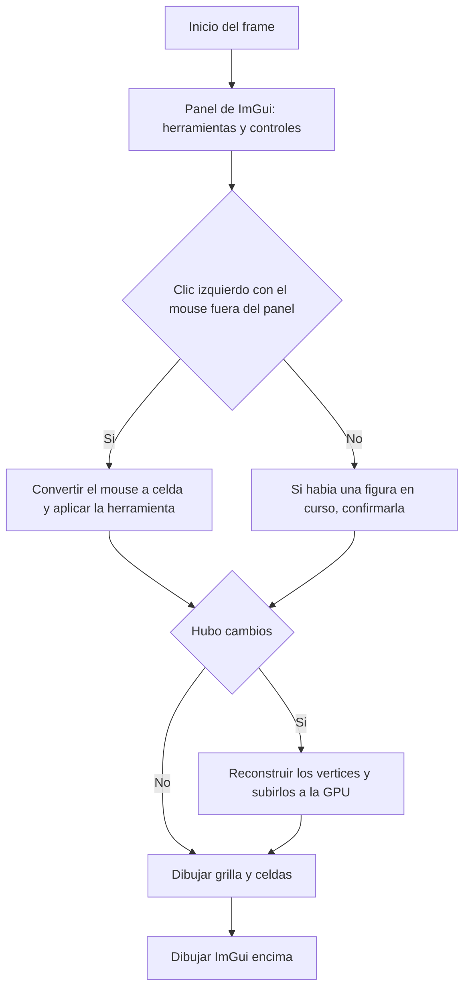

# Paint con Bresenham

Programa de dibujo (paint) sobre una grilla de celdas, hecho en C++ con OpenGL para el curso de **Introducción a la Computación Gráfica**. Las figuras se calculan con el algoritmo de Bresenham y se manejan desde una interfaz hecha con Dear ImGui.

- **Autor:** Jose Luis Perez Vera
- **Curso:** Introducción a la Computación Gráfica, grupo MULB (11:00 a 2:00)
- **Video explicativo y demostración:https://drive.google.com/file/d/1vQvvP0mu2uwNJWfS-G6t_3nS1d9_C9o8/view?usp=sharing

## Qué hace

El programa muestra una grilla de 20 × 20 celdas. Cada celda está vacía o pintada con un color, y el usuario dibuja con el mouse eligiendo una herramienta en el panel.

| Herramienta | Qué hace |
|---|---|
| Pincel | Dibuja a mano alzada. Une cada posición del mouse con la anterior usando Bresenham, para que el trazo no quede con huecos. |
| Borrador | Igual que el pincel, pero vacía las celdas. |
| Relleno | Llena la zona conectada a la celda donde se hace clic (relleno por inundación). Sirve para llenar el interior de las figuras. |
| Línea | Línea de Bresenham con vista previa. Se puede forzar la orientación: libre, horizontal, vertical o diagonal de 45°. |
| Círculo | Círculo con el algoritmo del punto medio. El centro es el clic y el radio llega hasta el mouse. |
| Cuadrado | Contorno de un cuadrado armado con cuatro rectas de Bresenham. |
| Triángulo | Contorno de un triángulo armado con tres rectas de Bresenham. |
| Transformaciones | Mover, girar y escalar todo el dibujo con controles deslizantes. |
| Selector de color | Cada celda guarda el color con el que se pintó. |
| Borrar todo | Deja la grilla vacía. |

Las líneas, círculos, cuadrados y triángulos muestran una **vista previa** mientras se arrastra el mouse, y se pintan al soltar el clic.

## Tecnologías

- C++ con Visual Studio
- OpenGL 3.3 (core profile)
- GLFW (ventana, mouse y teclado)
- GLAD (carga de funciones de OpenGL)
- Dear ImGui (interfaz)

## Estructura del proyecto

```
PaintConBrasenham/
├── Main.cpp        Todo el programa: algoritmos, interfaz y dibujo
├── glad.c          Cargador de OpenGL
├── imgui/          Dear ImGui y sus backends para GLFW y OpenGL3
├── Libraries/      Dependencias del proyecto
└── README.md
```

## Arquitectura del código

Todo el programa está en `Main.cpp`. Se divide en funciones que calculan celdas (los algoritmos) y un `main()` que se encarga de la ventana, la interfaz y el dibujo. Los algoritmos no dependen de OpenGL: reciben números y devuelven celdas `(columna, fila)`.

### Funciones

| Función | Responsabilidad |
|---|---|
| `bresenhamLine` | Celdas de una recta entre dos celdas, con parámetro de decisión. Cubre los 8 octantes. |
| `bresenhamCircle` | Celdas del contorno de un círculo con el algoritmo del punto medio. |
| `calcularFigura` | Arma las celdas de línea, círculo, cuadrado o triángulo a partir del clic y la posición del mouse. |
| `ajustarOrientacion` | Fuerza la línea a horizontal, vertical o diagonal de 45°. |
| `rellenar` | Relleno por inundación con una pila y vecinos en 4 direcciones. |
| `transformarDibujo` | Traslación, rotación y escala del dibujo completo. |
| `framebuffer_size_callback` | Ajusta el área de dibujo cuando cambia el tamaño de la ventana. |
| `main` | Ventana, ImGui, shaders, buffers y ciclo principal. |

### Datos principales

| Variable | Contenido |
|---|---|
| `celdas` | `N * N` enteros: 0 si la celda está vacía y 1 si está pintada. La celda `(i, j)` está en `celdas[j * N + i]`. |
| `colores` | Tres números (rojo, verde y azul) por celda. |
| `vistaPrevia` | Celdas de la figura que se está arrastrando, todavía sin confirmar. |
| `celdaVertices` | Triángulos de las celdas pintadas, con 5 números por vértice: `x, y, r, g, b`. |
| `gridVertices` | Las líneas de la grilla. |

### Cómo se dibuja

La grilla ocupa la ventana de -1 a 1 en cada eje, y cada celda mide `step = 2.0 / N`. Cada celda pintada se convierte en un cuadrado formado por dos triángulos. Hay dos conjuntos de buffers (VAO y VBO): uno estático para la grilla, que se dibuja con `GL_LINES`, y uno dinámico para las celdas, que se dibuja con `GL_TRIANGLES` y se vuelve a subir a la GPU solo cuando algo cambia.

Los shaders son dos. El de vértices recibe la posición y el color de cada vértice. El de fragmentos pinta con el color del vértice (celdas) o con un color fijo (grilla), según el uniform `uUsarColorVertice`.

### Ciclo principal

En cada frame se hace lo siguiente:



## Algoritmos

### Línea de Bresenham

Decide qué celdas pintar entre dos puntos usando solo enteros. En cada columna, el parámetro de decisión `p` indica si la fila cambia o se queda igual:

```cpp
int p = 2 * dy - dx;            // parámetro de decisión inicial

for (int x = x0; x <= x1; x++)
{
    // guardar la celda (x, y)
    if (p > 0)
    {
        y += ystep;             // la fila cambia
        p += 2 * dy - 2 * dx;
    }
    else
    {
        p += 2 * dy;            // la fila se queda igual
    }
}
```

Si la línea es más vertical que horizontal (`steep`), se intercambian `x` e `y` antes de calcular y se devuelven a su lugar al guardar cada celda. Así se cubren los 8 octantes, es decir, líneas en cualquier dirección.

### Círculo (punto medio)

Solo se calcula un octavo del círculo y los otros siete salen por simetría. El parámetro de decisión empieza en `p = 1 - r`. Si `p < 0`, la siguiente celda queda en la misma fila y `p` aumenta en `2x + 1`. Si no, se baja una fila y `p` aumenta en `2(x - y) + 1`.

### Cuadrado y triángulo

No tienen un algoritmo propio: se arman uniendo sus vértices con rectas de Bresenham. El cuadrado usa el lado menor entre el ancho y el alto arrastrados para que siempre sea cuadrado. El triángulo tiene la base en la fila del clic y la punta en la fila del mouse.

### Relleno por inundación

Parte de la celda del clic y se extiende por las celdas vecinas que sean iguales a ella (vacías, o pintadas del mismo color), usando una pila. Solo usa los 4 vecinos (arriba, abajo, izquierda y derecha) para que no se escape por los pasos diagonales de las rectas de Bresenham.

### Transformaciones

Se aplican a todo el dibujo. La rotación y la escala son respecto al centro del dibujo, y la posición final es:

```
p' = centro + escala * R(ángulo) * (p - centro) + traslación
```

donde `R` es la matriz de rotación `[cos -sen; sen cos]`. Para que no queden huecos, la función recorre cada celda del resultado y calcula de qué celda original viene (transformación inversa), en vez de mover cada celda original hacia adelante.

## Interfaz (Dear ImGui)

El panel flotante contiene:

- Selector de color
- Botones de opción para las siete herramientas
- Selector de orientación (solo con la línea)
- Botón "Borrar todo"
- Transformaciones: Mover X, Mover Y, Ángulo, Escala, y los botones "Aplicar" y "Restablecer"

Cuando el mouse está sobre el panel, el programa no pinta en la grilla (`io.WantCaptureMouse`).

## Cómo compilar y ejecutar

1. Abrir el proyecto en Visual Studio.
2. Verificar que GLFW y GLAD estén enlazados, y que los 16 archivos de ImGui estén agregados al proyecto: los 11 de la raíz de ImGui y los 5 de `backends` (`imgui_impl_glfw` e `imgui_impl_opengl3`).
3. Agregar `$(ProjectDir)imgui` a los directorios de inclusión adicionales.
4. Compilar y ejecutar.

## Cómo usar

1. Elegir un color y una herramienta en el panel.
2. Mantener el clic izquierdo y arrastrar sobre la grilla.
3. Para llenar una figura, elegir **Relleno** y hacer clic dentro de ella.
4. Para transformar el dibujo, mover los controles y presionar **Aplicar**.
